# 제주 축제 메이커 사용자 매뉴얼

제주 축제 메이커는 우리 동네에서 축제를 열고 싶은 분(마을회, 상인회, 지역 생산자 단체, 작은 기획사)을 위한 도구입니다.
조건을 적으면 **아이디어 → 제주 데이터로 확인 → 기획서 → 홍보물** 순서로 만들어 줍니다.

- 큰따옴표("")로 적은 문장은 화면에 나오는 문장을 그대로 옮긴 것입니다. 버튼 이름도 화면과 같습니다.
- 설치와 실행은 [install.md](install.md), 안내 문구가 나왔을 때 할 일은 [troubleshooting.md](troubleshooting.md)를 보세요.
- API 키 발급·설정(Gemini, 제주데이터허브)은 [install.md](install.md)의 3절과 3-1절 "제주데이터허브 API 키 발급·설정 (선택)"을 보세요. 제주데이터허브 키는 앱 실행에는 필요 없습니다.
- 공개 데이터 원본부터 가공본을 다시 만드는 방법은 [data-spec.md](data-spec.md) 3-4절 "가공본 다시 만들기"를 보세요.

## 한눈에 보기

| 단계 | 화면 맨 위 제목 | 내가 하는 일 | 받는 것 |
|---|---|---|---|
| ① 조건 입력 | "어떤 축제를 열고 싶나요?" | 한 문장 쓰기 → 칸 확인 → **아이디어 보기** | 지역·목적·소재·계절·대상·예산 칸 |
| ② 아이디어 | "아이디어 3개를 골라왔어요" | 카드 3장 중 하나를 **자세히 보기** → **이 아이디어 고르기** | 아이디어 카드 3장과 근거 |
| ③ 데이터로 확인 | "제주 데이터로 확인했어요" | 결과를 읽고, 필요하면 직접 고쳐서 다시 확인 → **이대로 진행** | 확인 결과 5개, 바뀐 점 |
| ④ 기획서 | "기획서 초안이 나왔어요" | 읽어 보고 **기획서 최종 승인** | 표·KPI 카드로 구성된 기획서 |
| ⑤ 홍보물 | "홍보물 시안이에요" | **홍보물 만들기** → 포스터 내려받기, 글 복사 | 포스터(1200×1600 그림), SNS 글, 정보 일치 검사 |

- 화면 위쪽 단계 표시(01 조건 입력 … 05 홍보물)로 지금 어디인지 볼 수 있습니다.
- ② 아이디어 화면에서는 상단의 **✓ 01 조건 입력**을 눌러 입력 화면으로 돌아갑니다. 별도 뒤로 버튼이나 본문의 중복 단계 문구는 표시하지 않습니다.
- ③·④·⑤ 화면에도 별도 뒤로가기 버튼은 없습니다. 상단에서 체크 표시가 있는 완료된 단계 탭을 눌러 돌아갑니다. 아직 진행하지 않은 단계는 누를 수 없습니다. 앞 단계에서 값을 바꾸면 뒤 단계 결과는 지워지고 다시 만듭니다.
- 왼쪽 접힌 설정 패널을 열면 상단 로고 없이 "설정" 제목과 AI 설정 상태가 보입니다.
  - 키가 있으면 "사용 가능 / 함께 기획할 준비가 됐어요"
  - 설명: "문장으로 조건을 정리하고, 아이디어와 기획서 문장을 만드는 데 AI를 사용합니다."
  - 키가 없으면 "설정 필요 / 예시 카드로 먼저 둘러보세요"
  - 설명: "AI 설정이 없으면 한 문장 입력·새 카드·기획서는 안내 문구로 대신해요. 예시 카드로 흐름을 볼 수 있어요."
- 설정 패널 아래쪽에는 "이렇게 사용해주세요" 안내가 있습니다. 창이 낮으면 스크롤해서 볼 수 있습니다.
  1. 원하는 축제를 적어주세요
  2. 아이디어를 골라주세요
  3. 제주 데이터로 확인할 수 있어요
  4. 기획서를 확인하고 승인해주세요
  5. 홍보물을 만들어줍니다
- 이용 순서 아래에는 여백을 두고 "전국 축제에서 아이디어를 찾고, 제주 데이터로 우리 동네에 맞게 다듬어요."가 표시됩니다.

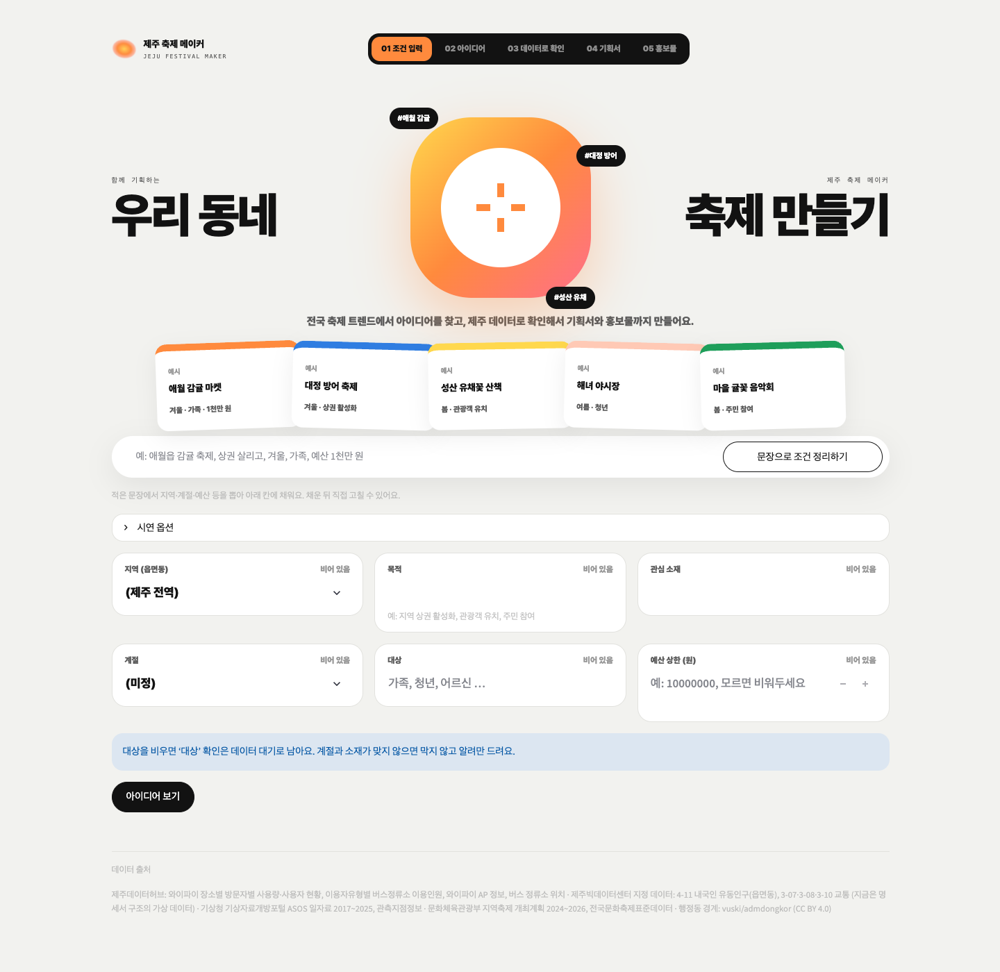

*첫 화면. 위쪽에 단계 표시, 가운데에 한 문장 입력 칸, 아래에 조건 칸 6개가 있습니다.*

---

## ① 조건 입력

### 1. 한 문장으로 적기

1. 가운데 입력 칸에 원하는 축제를 한 문장으로 적습니다.
   - 칸 안 예시: "예: 애월읍 감귤 축제, 상권 살리고, 겨울, 가족, 예산 1천만 원"
2. 오른쪽 **문장으로 조건 정리하기**를 누릅니다.
   - 칸 아래 안내: "적은 문장에서 지역·계절·예산 등을 뽑아 아래 칸에 채워요. 채운 뒤 직접 고칠 수 있어요."
3. AI가 문장에서 조건을 뽑아 아래 칸을 채웁니다. 각 칸 위에 어떻게 채워졌는지 표시됩니다.
   - "AI가 채움": AI가 채운 칸
   - "입력함": 내가 채운 칸
   - "비어 있음": 빈 칸
4. 판단한 내용을 파란 안내로 알려 줍니다. 예:
   - "12월을(를) 겨울로 봤어요."
   - "여러 계절의 달이 섞여 있어 계절을 비워 뒀어요."
   - "'일도동'을(를) 읍면동으로 정하지 못했어요. 지역을 직접 골라주세요."

- 문장은 300자 안으로 써 주세요. 넘으면 "300자 안으로 줄여서 적어주세요."가 나옵니다.
- AI 설정이 없으면 "AI 설정이 없어요. 아래 칸에 조건을 직접 입력해주세요."가 나옵니다. 이때는 2번의 칸에 직접 입력하세요.

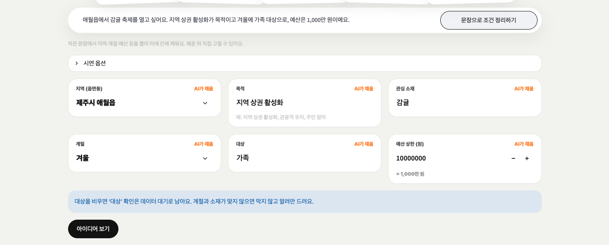

*"애월읍에서 감귤 축제를…" 문장을 정리한 뒤. AI가 채운 칸에 "AI가 채움" 표시가 붙고, 아래에 파란 안내가 나옵니다.*

### 2. 조건 칸 확인·고치기

**모든 칸은 선택입니다.** 모르는 칸은 비워 두세요.

| 칸 | 넣는 것 | 비워 두면 |
|---|---|---|
| 지역 (읍면동) | 목록에서 행정동·읍면 43곳 중 하나 | "(제주 전역)". 시기·장소·대상 확인은 "데이터 대기"가 됩니다 |
| 목적 | 자유롭게. 칸 아래 "예: 지역 상권 활성화, 관광객 유치, 주민 참여" | 목적 없이 아이디어를 고릅니다 |
| 관심 소재 | 방어, 감귤, 유채꽃처럼 제주 재료 | 재료를 정하지 않고 고릅니다 |
| 계절 | 봄 / 여름 / 가을 / 겨울 | "(미정)" |
| 대상 | 가족, 청년, 어르신 … (칸 안 예시와 같음) | 대상 확인이 "데이터 대기"가 됩니다 |
| 예산 상한 (원) | 숫자만. 칸 안 예시: "예: 10000000, 모르면 비워두세요" | 같은 형식 축제의 예산 중간값을 참고 금액으로 보여줍니다 |

칸 아래 안내: "대상을 비우면 ‘대상’ 확인은 데이터 대기로 남아요. 계절과 소재가 맞지 않으면 막지 않고 알려만 드려요."

### 3. 시연 옵션 (발표·연습용)

- 조건 칸 바로 위의 **시연 옵션**을 펼치면 "시연용 예시 카드 보기 (AI 없이)" 체크 칸이 있습니다.
- 체크하면 조건 칸이 바로 채워지고 다음 안내가 나옵니다.
  - 채워지는 값: 지역 제주시 애월읍, 목적 지역 상권 활성화, 소재 감귤, 계절 겨울, 대상 가족, 예산 10,000,000원
  - "애월·겨울·감귤·가족·1,000만 원 조건을 채웠어요. 아래에서 확인·수정한 뒤 ‘아이디어 보기’를 눌러주세요. AI는 사용하지 않아요."
- 채워진 값은 고칠 수 있습니다.
- 카드는 AI를 쓰지 않고 **애월 감귤 예시 카드 3장**이 나옵니다. 칸 값을 바꿔도 카드는 같습니다.
- 확인 도구 5개는 **칸에 적힌 지역**으로 실제 데이터를 계산합니다.
- ②의 접힌 **예시 카드예요 → 설명 보기** 안내를 열면 다음 설명과 시연 카드의 데이터 범위를 볼 수 있습니다.
  - "예시 카드 보기가 켜져 있어요. 입력한 조건과 상관없는 시연용 카드예요. ① 조건 입력에서 체크를 끄면 입력한 조건으로 AI가 카드를 만들어요."

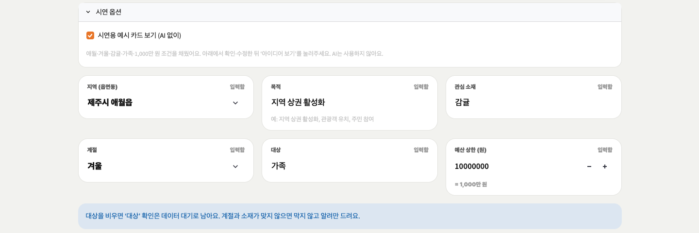

*시연 옵션을 켠 모습. 체크하면 애월읍·지역 상권 활성화·감귤·겨울·가족·1,000만 원이 바로 채워집니다.*

### 4. 아이디어 보기

**아이디어 보기**를 누르면 "아이디어 카드를 만들고 있어요" 화면으로 바뀝니다.

- "숫자는 코드가 계산하고, AI는 카드 문장만 써요. 보통 20초쯤 걸려요."
- 진행 상황이 네 줄로 표시됩니다. 오른쪽 "코드"·"AI"는 누가 하는 일인지 뜻합니다.

| 순서 | 하는 일 | 누가 |
|---|---|---|
| 1 | "전국 축제 트렌드 계산" | 코드 |
| 2 | "형식 × 제주 재료 조합 점수" | 코드 |
| 3 | "3개 고르고 카드 문장 쓰기" | AI |
| 4 | "확인할 가설 정리" | 코드 |

- 가끔 AI가 쓴 카드가 규칙 검사(후보 3개, 숫자 사용 등)를 통과하지 못합니다. 그러면 ① 화면으로 돌아와 다음이 보입니다.
  - "AI가 조건에 맞는 카드를 만들지 못했어요. 다시 시도해 주세요."
  - **다시 받기** 버튼을 누르세요. 시험 실행에서는 1~3번 안에 모두 받았습니다.

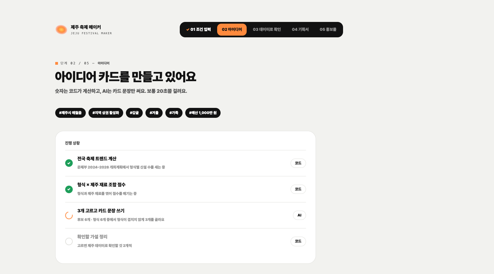

*아이디어 카드를 만드는 중. 진행 상황 네 줄 가운데 "3개 고르고 카드 문장 쓰기"(AI)를 하고 있습니다.*

---

## ② 아이디어

맨 위: "아이디어 3개를 골라왔어요" / "전국에서 늘고 있는 축제 형식과 제주 재료를 엮었어요. 근거를 보고 하나를 골라주세요."

- 위쪽 칩(#제주시 애월읍, #겨울 …)은 ①에서 정한 조건입니다.
- 시연 카드는 회색 한 줄의 **예시 카드예요** 안내로 표시됩니다. **설명 보기**를 누르면 예시 카드가 나온 이유, 입력 조건과의 차이, 예시 카드 보기를 끄는 방법과 데이터 범위를 확인할 수 있습니다.
- 카드 세 장은 같은 높이와 중립적인 테두리로 표시하며, 하단의 **자세히 보기** 버튼 위치를 맞춥니다.
- 입력한 계절과 재료 제철이 맞지 않으면 노란 안내가 나옵니다. 막지는 않습니다.
  - 예: "감귤은 11·12·1월이 제철이라 여름과 맞지 않아요. 계절이나 재료를 바꿔보세요."
- 관심 소재가 제주 재료 목록에 없으면 파란 안내가 나옵니다.
  - 예: "'고등어'은(는) 아직 제주 소재 목록에 없어서 재료를 고정하지 않고 추천했어요."

### 카드 한 장에 있는 것

- 형식 × 재료 (예: 시장·상권 × 방어), 축제 이름, 한 줄 컨셉
- 요약 줄. 줄마다 근거 종류 태그가 붙습니다.
  - "데이터": 출처 자료에서 확인한 값이에요.
  - "에이전트 해석": 데이터를 바탕으로 에이전트가 분석하고 제안한 내용이에요.
- 방문객 수처럼 축제별 집계 방식이 다른 값에는 "참고 수치" 안내를 사용합니다. 예산으로 환산한 인원 범위는 "에이전트 해석"으로 구분합니다.
- "고르면 확인할 것": ③에서 확인할 가설 2개
- **자세히 보기** 버튼

### 자세히 보기 → 고르기

**자세히 보기**를 누르면 "아이디어 자세히 보기" 창이 열립니다.

- 전국 트렌드: "2023년 이후 신설" 수, "신설 비율", 판정
  - "신설 비율은 기존 축제 대비 새 축제의 형식 비율이에요."
- 제주 현황: 같은 형식 축제 수, 비슷한 소재의 제주 축제와 개최 월, 추천 월에 열리는 제주 축제 수
- 예산: "입력한 예산"과 "같은 형식 중앙값" 막대 비교, 작은 예산 사례

마음에 들면 **이 아이디어 고르기**, 아니면 **닫기**를 누릅니다.

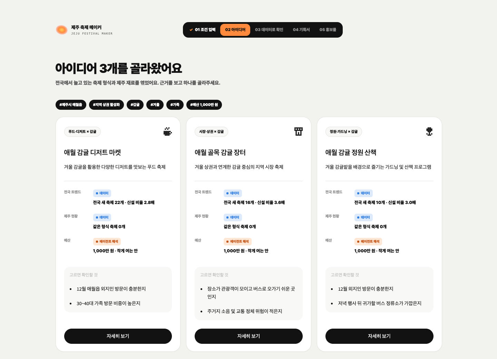

*애월 감귤 조건으로 AI가 만든 카드 3장(푸드·디저트, 시장·상권, 정원·가드닝 형식).*
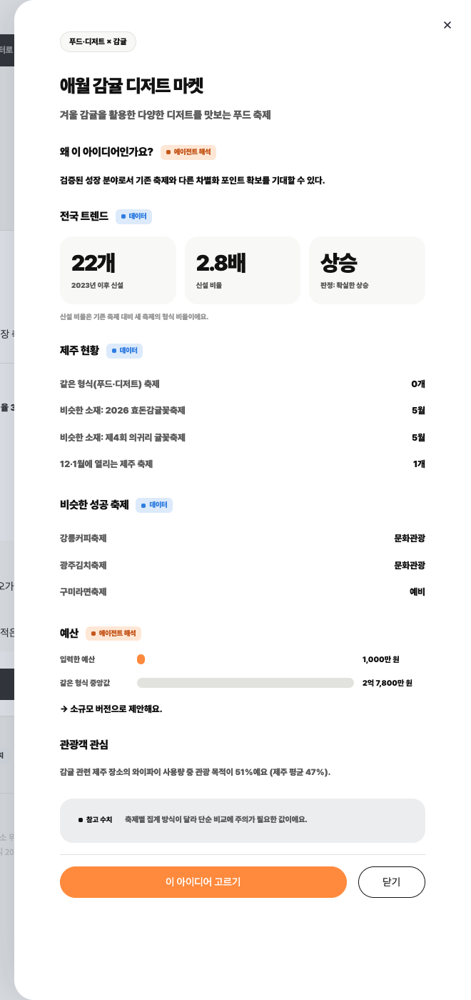

*"아이디어 자세히 보기" 창. 전국 트렌드 숫자 3칸, 제주 현황, 비슷한 성공 축제, 예산 막대가 나옵니다.*

---

## ③ 데이터로 확인

맨 위: "제주 데이터로 확인했어요" / "고른 아이디어의 가설을 확인 도구 5개로 살펴봤어요. 실패한 항목은 에이전트가 고쳐서 다시 확인해요."

확인하는 동안 "확인 도구 5개를 돌리는 중이에요…"가 보입니다. 보통 1~10초 걸립니다.

### 1. 확인 결과 5개

"에이전트 추천안: 개최 월 1·2월 · 장소 (정하지 않음) · 규모 작게"처럼 지금 안이 한 줄로 나오고, 그 아래 결과 카드 5개가 있습니다.

| 확인 | 보는 것 |
|---|---|
| 시기 | 그 달 외지인 방문이 평소보다 많은지, 날씨(폭우·강풍)가 평소보다 나쁜지, 가까운 곳에서 같은 재료 축제가 같은 달에 열리는지 |
| 장소 | 그 동네에 관광객이 모이는 장소가 있고, 걸어갈 수 있는 거리(500m)에 버스 정류소가 있는지 |
| 대상 | 그 동네 와이파이 사용자 중 대상 연령대 비중이 제주 평균보다 높은지 |
| 위험 | 같은 재료 축제와 겹침, 밤에 사는 사람이 많아 소음 민원 걱정이 있는지, 도로 정체 |
| 규모 | 입력 예산으로 같은 형식 축제를 연 사례가 있는지, 그 예산이면 몇 명 규모인지 |

각 카드에는 다음이 있습니다.
- 결과 표시: "통과" / "조건부" / "실패" / "데이터 대기"
  - 가상 데이터를 쓴 결과에는 "🧪 가상 데이터 포함"이 붙습니다
- 이유 한 문장
- 주요 숫자. 예: "외지인 방문 지수(연평균 1): 1월 1.03, 2월 0.92"
- 장소 확인에는 장소 후보 표가 있습니다: 장소, 동네, 관광 비중, 가까운 정류소, 거리, 정류소 하루 이용
- "출처: …"
- **주의할 점**(펼치기): 데이터 한계와 참고 사항

자료가 적은 동네(예: 추자면)는 위에 다음 안내가 붙습니다.
- "⚠️ 이 지역은 자료가 적어 결과가 불안정할 수 있어요. …"

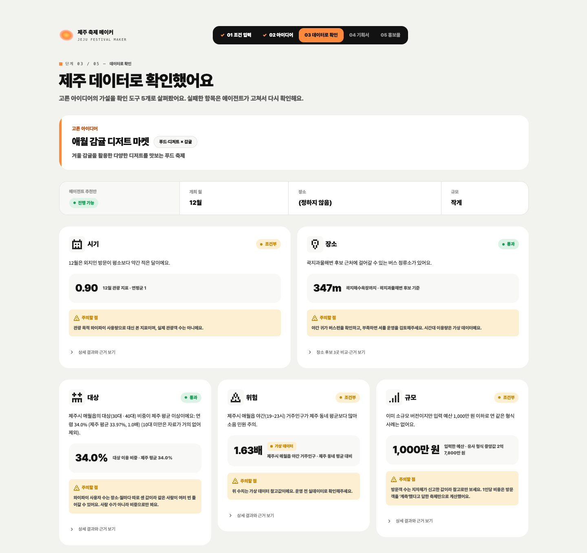

*확인 결과 카드 5개(시기·장소·대상·위험·규모). 장소 후보 표는 장소 카드의 "장소 후보 3곳 비교·근거 보기"를 펼치면 보입니다.*

### 2. 바뀐 점

처음 확인에서 실패한 항목이 있으면, 에이전트가 고친 뒤 다시 확인합니다(최대 3번). 무엇을 왜 바꿨는지가 쉬운 말로 나옵니다.

- 제목 예: "추천 시기: 11·12·1·2월 → 1·2월"
- 이유 예: "11월에는 같은 동네(서귀포시 대정읍)에서 같은 재료 축제(제26회 최남단 방어 축제)가 열려요. 12월은 바람이 강한 주가 많아요."
- 조건부로 남은 달 안내 예: "⚠️ 2월은 평소보다 관광객이 약간 적지만, 제철 안에서 가장 나은 달이에요."
- 입력한 계절 밖으로 옮겼으면: "⚠️ 입력한 계절(여름)에는 맞는 달이 없어 2월로 바꿨어요." (시기 결과 카드에도 같은 문장)
- 바꾼 게 없으면: "바뀐 점이 없어요."
- **확인 과정 자세히 보기**를 펼치면 회차별 결과가 나옵니다. 예: "처음 확인: 시기 ❌ 실패, 장소 ✅ 통과, …"

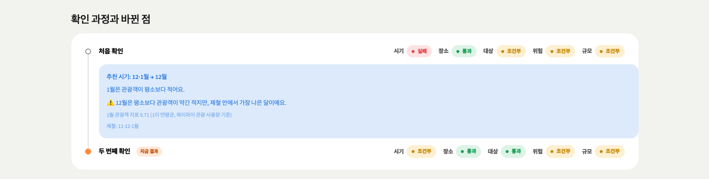

*애월 감귤 예에서 처음 확인 때 시기가 ❌ 실패해, 에이전트가 12·1월을 12월로 고쳐 다시 확인한 모습.*

### 3. 직접 고쳐서 다시 확인

에이전트 추천안과 다르게 해 보고 싶을 때 씁니다.

- 안내: "개최 월·장소·규모를 바꿔서 확인만 다시 해요. 자동으로 고치지는 않아요."
- 바꿀 수 있는 것
  - **개최 월**: 한 달만 고릅니다. 처음 값은 지금 안의 첫 달입니다
  - **장소 (장소 후보 표에서)**: 장소 후보 표의 장소 또는 "(정하지 않음)"
  - **규모**: "기본" / "작게"
- **이 조건으로 다시 확인**을 누르면 "에이전트 추천안"과 "내가 고친 안" 탭이 생깁니다. 두 안의 결과를 비교할 수 있습니다.
- 어느 달이 나을지 모르겠으면, 시기 카드의 **상세 결과와 근거 보기**를 펼쳐 **12개월 한눈에 보기** 표를 먼저 보세요.
  - 같은 동네·소재로 1~12월을 한 달씩 확인한 결과입니다. AI는 쓰지 않습니다.
  - 칸: 월, 입력 계절(●는 입력한 계절 안의 달), 외지인 지수, 날씨 나쁜 주, 같은 재료 축제(10km 안이면 "(가까움)"), 판정(✅ 통과 / ⚠️ 조건부 / ❌ 실패)

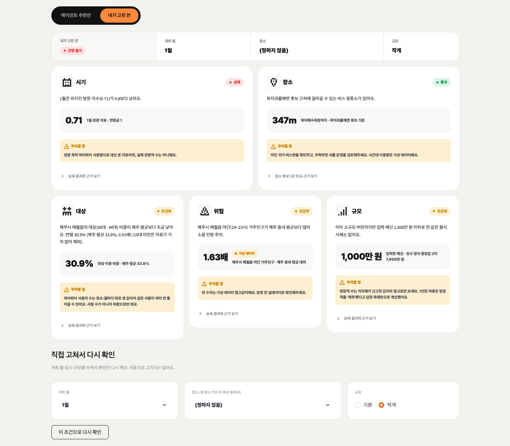

*개최 월을 1월로 바꿔 다시 확인한 모습. "에이전트 추천안"과 "내가 고친 안" 탭이 생기고, 아래에 개최 월·장소·규모 칸이 있습니다.*

### 4. 어느 안으로 진행할까요?

1. "에이전트 추천안" / "내가 고친 안" 중 하나를 고르고 **이대로 진행**을 누릅니다.
2. 실패(❌)가 남은 안은 진행할 수 없습니다(버튼이 꺼짐).
   - 에이전트 추천안: "고쳐도 통과하지 못한 확인이 있어요. 직접 고쳐서 다시 확인하거나 다른 아이디어를 골라보세요."
   - 내가 고친 안: "❌ 항목이 남아 있어 기획서를 만들 수 없어요. 다른 값을 바꿔서 다시 확인해보세요."

---

## ④ 기획서

맨 위: "기획서 초안이 나왔어요" / "근거·가정·미확인 사항을 나눠 적었어요. 최종 승인하면 이 내용 그대로 홍보물을 만들어요."

"기획서를 쓰는 중이에요…"가 보이고 5~10초 뒤 기획서가 나옵니다.

### 기획서 읽기

왼쪽은 기획서 본문, 오른쪽은 "승인 전 확인" 패널입니다.

화면 본문은 표·KPI 카드·프로그램·일정 목록으로 구성된 16개 항목입니다:
1. 사업 개요
2. 추진 배경·필요성
3. 목표·KPI
4. 기본 컨셉
5. 세부 프로그램 (제안)
6. 추진 일정
7. 예산 계획
8. 홍보 계획
9. 운영 계획
10. 위험 관리
11. 기대효과
12. 데이터 검증 결과 요약
13. 참고 사례
14. 성과 측정 방법
15. 가정과 한계
16. 데이터 출처

생성 직후와 최종 승인 시에는 파일을 자동 저장하지 않습니다. Edit의 **수정 내용 적용**은 현재 화면의 기획서만 갱신합니다. 파일은 다운로드 버튼을 눌렀을 때만 내려받습니다.

- 숫자·출처·확인 결과·일정 표는 코드가 넣고, 문장은 AI가 씁니다.
- 날짜, 행사장, 주최·주관, 항목별 예산처럼 정해지지 않은 것은 "미확인"으로 적습니다.

오른쪽 패널:
- 문서 상단에 버전(예: "v1 초안")을 표시하고, 오른쪽에는 "승인 전 확인" 안내가 있습니다.
- "에이전트 추천안으로 기획서를 만들었어요." (고른 안 이름)
- 가상 데이터가 섞였으면 노란 주의 안내가 보입니다. 실제 판단 전 실데이터로 다시 확인해야 합니다.
- "기획서를 최종 승인하면 홍보물을 만들 수 있어요."

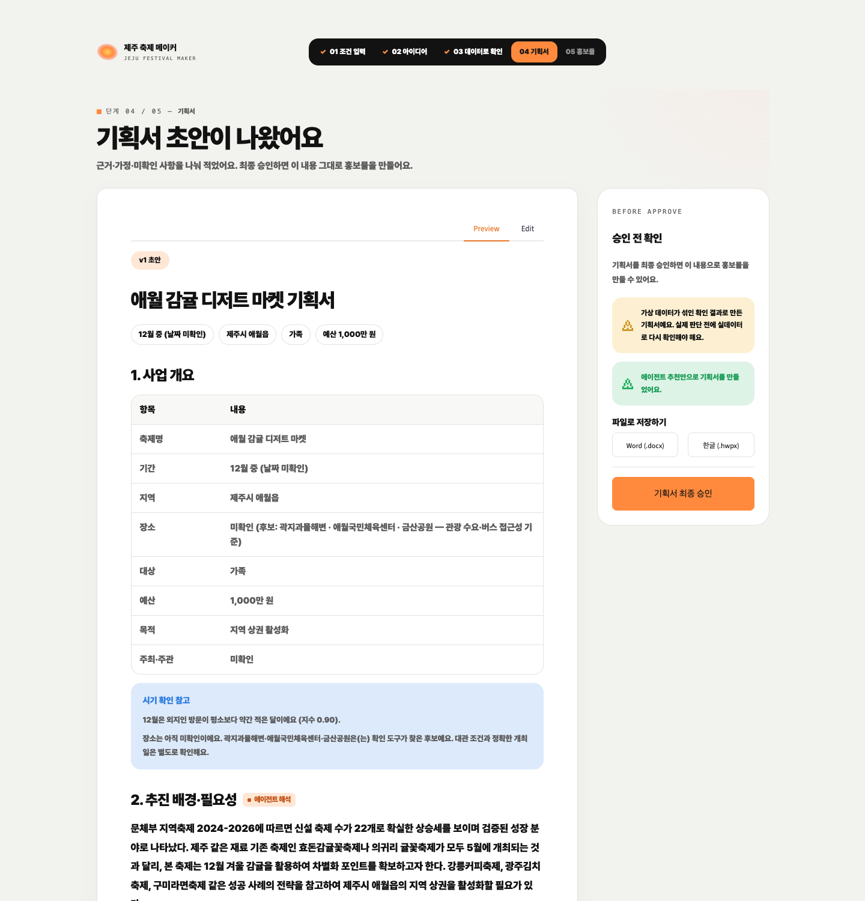

*기획서 화면. 왼쪽은 기획서 본문(v1 초안), 오른쪽은 "승인 전 확인" 패널입니다.*

### 기획서를 만들지 못했을 때

AI가 쓴 문장이 규칙(정하지 않은 장소를 확정처럼 쓰지 않기, 근거에 없는 숫자 쓰지 않기 등)에 맞지 않으면 기획서를 만들지 않습니다.
이유가 한 줄로 나오고 **다시 만들기** 버튼이 생깁니다.

- 예: "AI가 정하지 않은 장소를 정한 것처럼 써서 기획서를 쓰지 않았어요. 다시 만들어 보세요."

### 최종 승인

1. 내용을 읽고 **기획서 최종 승인**을 누릅니다.
2. 현재 기획서를 승인 상태로 바꾸고 ⑤ 홍보물로 넘어갑니다. 파일은 자동 저장하지 않습니다.
3. 승인 뒤 ④로 돌아오면 다음이 보입니다.
   - 제목: "기획서를 최종 승인했어요"
   - 오른쪽: "승인 완료", "기획서를 최종 승인했어요.", **홍보물 만들러 가기**

**승인하지 않으면 홍보물을 만들 수 없습니다.**

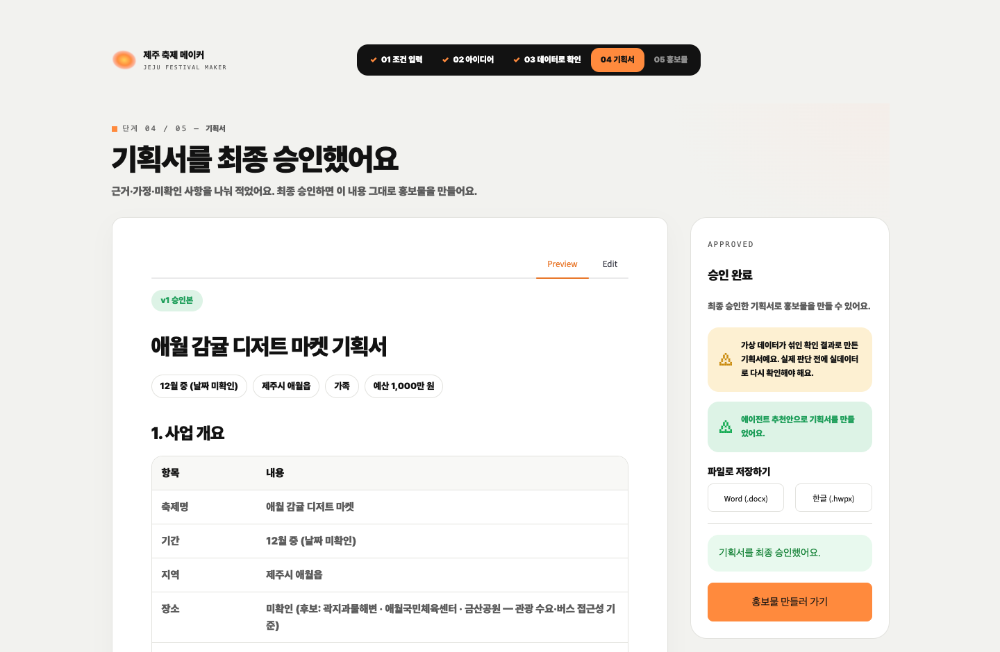

*최종 승인 뒤 ④로 돌아온 모습. 오른쪽에 "승인 완료" 패널과 "홍보물 만들러 가기" 버튼이 있습니다.*

---

기획서 본문 오른쪽 위에서 **Preview / Edit**를 전환할 수 있습니다.
- **Preview**: 저장된 기획서를 확인합니다. 수정 후에도 기존 문서 디자인을 유지합니다.
- **Edit**: Markdown 원문을 직접 수정합니다. 항목 제목, 사업 개요 표, `- **프로그램 이름**: 설명` 형식을 유지해주세요.
- **수정 내용 적용**: 수정본을 현재 화면에 반영합니다. 서버에 파일을 저장하지 않으며, 변경된 초안은 최종 승인이 다시 필요합니다.
- **.md 다운로드 / .json 다운로드**: 현재 적용된 기획서를 각 형식으로 내려받습니다. 수정 중인 내용이 있으면 먼저 **수정 내용 적용**을 눌러주세요.
- 오른쪽 최종 승인 버튼 아래 **Word (.docx)** / **한글 (.hwpx)** 버튼으로 저장된 기획서를 내려받을 수 있습니다. 제목·본문·표를 편집 가능한 문서로 변환하며, Edit에서 고친 내용도 적용 후 반영됩니다.
- 저장된 축제명·기간·장소·컨셉·프로그램을 홍보물 생성에 사용합니다.

## ⑤ 홍보물

맨 위: "홍보물 시안이에요" / "최종 승인한 기획서로 포스터와 SNS 글(인스타그램)을 만들고, 기획서와 같은지 검사해요. 게시는 직접 해 주세요."

**홍보물 만들기**를 누르면 "포스터와 SNS 글을 만드는 중이에요…"가 보입니다. 홍보물이 만들어지면 이 버튼은 사라집니다. 앞 단계에서 기획서나 확인 결과를 바꾸면 홍보물이 지워지고 버튼이 다시 나타납니다.

### 포스터 (왼쪽)

- "포스터 미리보기 (1200×1600)": 세로 3:4 그림입니다.
- **포스터 내려받기 (.png)**: `poster.png` 파일로 내려받습니다. 만들 때 컴퓨터의 `outputs/promo/` 폴더에도 저장됩니다.
- 포스터 종류는 키 상태에 따라 세 가지입니다.

| 종류 | 언제 | 화면 안내 |
|---|---|---|
| AI가 글자까지 그린 포스터 | 결제 설정한 키가 있고, 글자 검사를 통과 | "AI가 정한 문구만 포스터에 그렸는지 글자를 읽어 확인했어요." 그림 오른쪽 아래에 "이미지: AI 생성 (Gemini)" 표기 |
| AI 그림 + 글자 따로 얹은 포스터 | AI가 글자를 정확히 못 그림 (3번 시도) | "AI가 글자를 정확히 그리지 못해 글자를 따로 얹었어요." |
| 기본 포스터 (단색 바탕 + 글자) | 키가 없거나, 이미지 모델을 쓸 수 없는 키 | 노란 안내 + 그림 설명·포스터 문구 상자 (아래) |

- 포스터에는 기획서에 있는 이름·기간·장소·프로그램만 들어갑니다.
- 정해지지 않은 날짜·장소는 "날짜 추후 공지", "장소 추후 공지"로 씁니다.

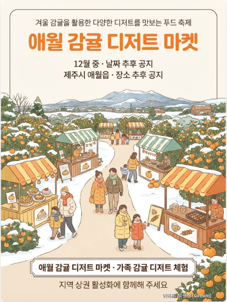

*AI가 한글 문구까지 그린 포스터. 기획서의 이름·기간·장소·프로그램만 들어가고, 정해지지 않은 날짜·장소는 "추후 공지"로 씁니다.*

### 그림 설명·포스터 문구 복사 (기본 포스터일 때)

이미지 모델을 쓰지 못하면 노란 안내가 나오고, 그 아래 **그림 설명과 포스터 문구 보기 (그대로 복사해 쓰세요)** 상자를 펼칠 수 있습니다. 예:

- "이미지 생성은 결제 설정한 키가 필요해요. 아래 그림 설명을 AI Studio에 붙여 넣으면 직접 만들 수 있어요."
- "그림 설명": 이미지 AI에 넣을 영어 그림 설명
- "포스터 문구": 포스터에 넣을 한국어 문구 6줄

상자에 마우스를 올리면 오른쪽 위에 **복사 아이콘**이 나옵니다. 누르면 전체가 복사됩니다.

### SNS 글 (오른쪽)

- "SNS 글" 카드: 오른쪽 위에 글자 수, 아래에 본문 3~5문장, 끝 줄 "언제: … · 어디: …", 해시태그 5개
  - 끝 줄 예: "언제: 1월, 2월 중 (날짜는 추후 공지) · 어디: 서귀포시 대정읍 (장소는 추후 공지)"
  - 이 줄은 AI가 아니라 코드가 기획서 값 그대로 붙입니다
- 카드 아래 **문구 복사** 버튼을 누르면 본문과 해시태그가 복사되고, 버튼 글자가 잠깐 "복사했어요"로 바뀝니다.
- 게시는 직접 해 주세요. 이 도구는 SNS에 올리지 않습니다.

### 정보 일치 검사

"정보 일치 검사" 카드(오른쪽 작은 글씨 "기획서와 같은지 · 포스터와 SNS 글 각각")에 한 줄에 한 항목씩 나옵니다. 같으면 주황색 **✓**, 다르면 ⚠️입니다.

- 포스터·SNS의 축제 이름·기간·장소가 기획서와 같은지
- 기획서에 없는 숫자가 없는지
- 기획서에 없는 프로그램(예: 드론 쇼)이 없는지
- 해시태그 5개인지

⚠️가 있으면 게시 전에 그 부분을 직접 고쳐 주세요.

가상 데이터가 섞인 기획서로 만들었으면 "🧪 가상 데이터가 섞인 기획서로 만든 홍보물이에요."가 나옵니다.

### 기획서와 함께 ZIP으로 저장

- **기획서와 함께 ZIP으로 저장**을 누르면 ZIP 파일 하나를 내려받습니다. 같은 ZIP이 컴퓨터의 `outputs/promo/` 폴더에도 남습니다.
- 버튼 아래 "저장되는 파일" 칩이 ZIP 안 파일 이름과 같습니다.
  - `poster.png`: 포스터
  - `plan.docx`: 기획서 Word
  - `plan.hwpx`: 기획서 한글
  - `plan.md`: 기획서 Markdown
- SNS 글은 ZIP에 넣지 않습니다. **문구 복사**로 가져가세요.

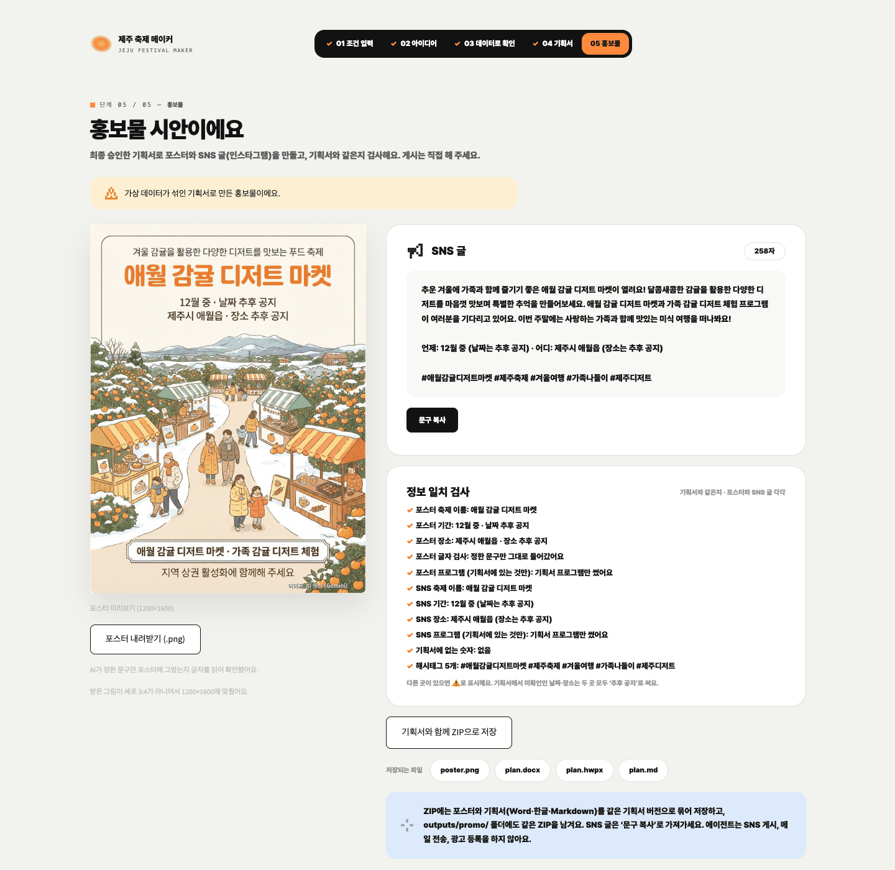

*홍보물 화면. 왼쪽에 포스터와 내려받기 버튼, 오른쪽에 SNS 글, 정보 일치 검사, ZIP 저장 버튼과 저장되는 파일이 있습니다.*

---

## 화면 아래

- 근거 배지 안내 패널은 **② 아이디어 화면에만** 표시됩니다. 카드 생성 중 화면과 ①·③·④·⑤ 단계에는 표시하지 않습니다.
  - **데이터**: 출처 자료에서 확인한 값이에요.
  - **에이전트 해석**: 데이터를 바탕으로 에이전트가 분석하고 제안한 내용이에요.
  - **참고 수치**: 축제별 집계 방식이 달라 단순 비교에 주의가 필요한 값이에요.
- "데이터 출처": 제주데이터허브, 제주빅데이터센터 지정 데이터, 기상청, 문화체육관광부, 행정동 경계(vuski/admdongkor, CC BY 4.0)

## 시연 순서 (예시)

1. ①에 "애월읍에서 감귤 축제를 열고 싶어요. 지역 상권 활성화가 목적이고 겨울에 가족 대상으로, 예산은 1,000만 원이에요."를 적고 **문장으로 조건 정리하기** → **아이디어 보기**
2. ②에서 카드 하나를 **자세히 보기** → **이 아이디어 고르기**
3. ③에서 시기 ❌ → "1월은 관광객이 평소보다 적어요"(1월 외지인 지수 0.71) → 감귤 제철 안에서 12월(0.90)로 고쳐 다시 확인한 흐름을 "바뀐 점"으로 설명. 장소는 곽지과물해변(곽지해수욕장 정류소 347m) ✅
4. **이대로 진행** → ④ 기획서 → **기획서 최종 승인**
5. ⑤ **홍보물 만들기** → 포스터 내려받기, SNS 글 복사, 정보 일치 검사 확인

AI를 쓸 수 없는 곳에서는 ①의 **시연 옵션**에서 "시연용 예시 카드 보기 (AI 없이)"를 켜고(애월·겨울·감귤 조건이 채워짐) 같은 순서로 진행합니다. 다만 기획서와 SNS 글은 AI가 있어야 만들어집니다.
