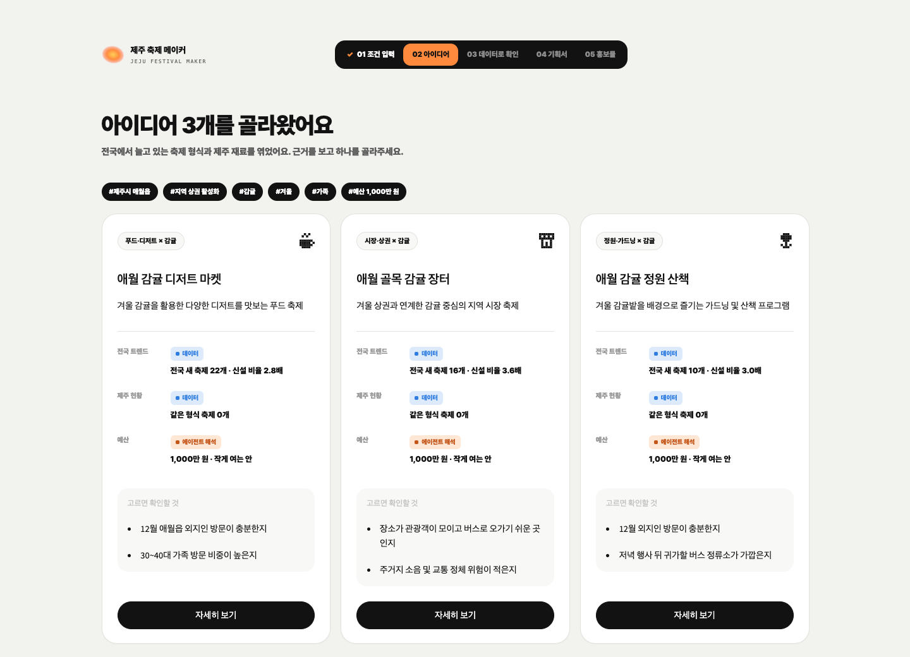
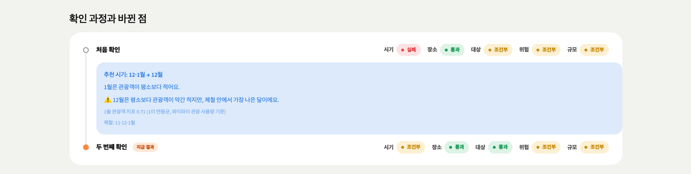
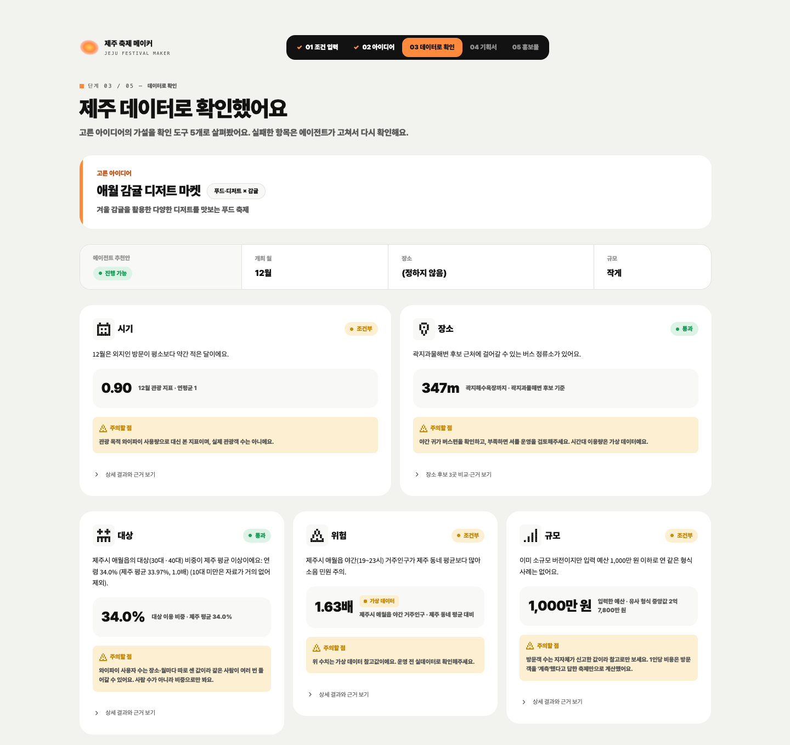
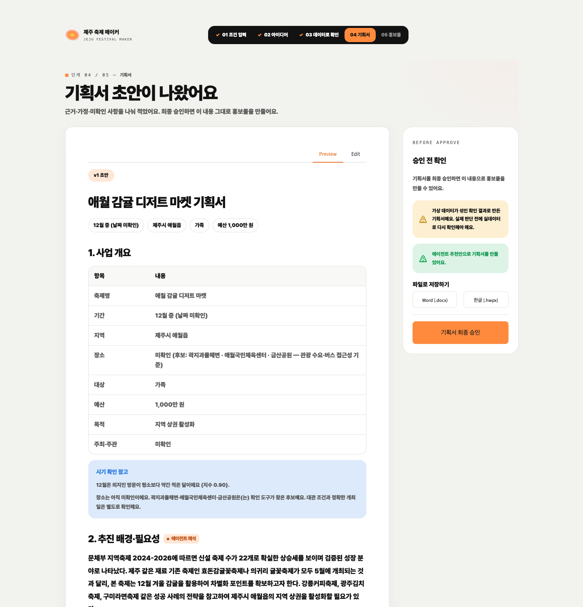
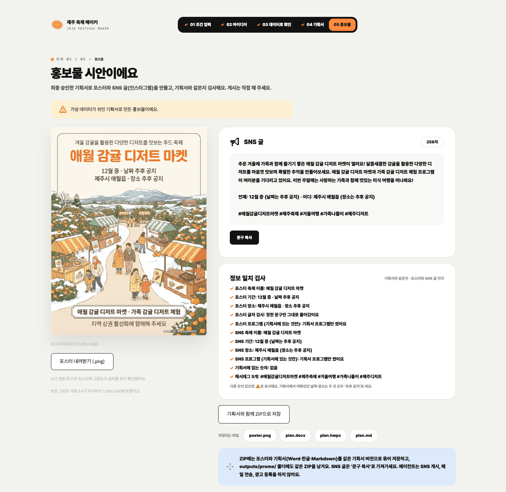

# 결과 설명자료

**제주 축제 메이커**가 무엇을 풀려고 했고, 어떻게 만들었고, 어떤 결과가 나왔는지 정리한 문서입니다.

- 설치·실행: 02_설치안내.pdf
- 화면 사용법: 03_사용매뉴얼.pdf
- 안내 문구와 한계: 04_오류와제약.pdf
- 데이터 출처와 실데이터 교체: 05_데이터활용명세.pdf
- AI 모델과 프롬프트: 06_프롬프트와모델.pdf

---

## 1. 문제 정의

> 제주를 찾는 내국인 관광객이 3년째 줄고 있다.
> 마을이 직접 사람을 부르는 축제, 이제는 감이 아니라 데이터로 기획해야 한다.

*출처: 내국인 관광객: 제주도관광협회 집계(2025년 잠정), 2023~2025년 연속 감소*

### 1-1. 누가 무엇을 어려워하나

제주에서 축제를 열고 싶은 **마을회, 상인회, 지역 생산자 단체, 작은 기획사**는 의지는 있지만 아래가 어렵습니다.

| 어려움 | 예 |
|---|---|
| 무엇을 할지 | "감귤 축제"는 떠올리지만, 요즘 전국에서 어떤 형식의 축제가 새로 생기는지 모른다 |
| 언제 할지 | 그 달에 관광객이 오는지, 바람·비가 잦은지, 근처에서 같은 재료 축제가 열리는지 모른다 |
| 어디서 할지 | 관광객이 모이는 곳, 걸어서 닿는 버스 정류소를 비교하기 어렵다 |
| 누구를 부를지 | 그 동네에 어떤 연령대가 오는지 근거가 없다 |
| 얼마로 할지 | 내 예산으로 비슷한 축제를 연 곳이 있는지 모른다 |
| 문서와 홍보 | 기획서 형식, 포스터·SNS 글을 만들 사람이 없다 |

- 필요한 데이터(문체부 축제 계획, 제주데이터허브, 기상청 등)는 공개되어 있습니다.
- 하지만 IT 비전문가가 이를 모아 판단에 쓰기는 어렵습니다.

### 1-2. 이 Agent가 하는 일

- 조건을 한 문장으로 적으면 **아이디어 → 제주 데이터로 확인 → 고쳐서 다시 확인 → 기획서 → 홍보물**까지 만들어 줍니다.
- 데이터마다 맡는 역할이 다릅니다.

| 역할 | 쓰는 데이터 |
|---|---|
| 아이디어의 출발점 | 문체부 지역축제 개최계획 2024~2026 (전국에서 새로 생기는 형식), 문화관광축제 지정 명단 |
| 확인과 수정의 근거 | 제주데이터허브 와이파이·버스, 제주빅데이터센터 지정 데이터, 기상청 날씨, 제주 축제 일정 |
| 실행할 수 있는지의 근거 | 같은 형식 축제의 예산, 작은 예산으로 연 사례 |

### 1-3. 지키는 원칙

- **숫자와 판정은 코드가, 문장은 AI가** 맡습니다. AI 문장에 근거 없는 숫자가 있으면 다시 쓰게 합니다.
- 모든 숫자에 출처(데이터 이름, 기간)를 붙입니다.
- "새 축제가 늘었다"(공급)와 "사람이 많이 온다"(수요)를 구분합니다. 문체부 방문객 수는 지자체가 직접 보고한 값이라 점수에 쓰지 않습니다.
- 정하지 않은 것(날짜, 행사장, 주최, 항목별 예산)은 AI가 채우지 않고 "미확인"으로 둡니다.
- 가상 데이터로 낸 결과는 화면·기획서·홍보물에 "가상 데이터"로 표시합니다.
- 방문객 수와 경제효과는 예측하지 않습니다.

### 1-4. 범위

- 소규모 1~2일 축제 (예산 비교는 2일 이상 축제 기준. 문체부 2026 조사에 1일 축제가 없음)
- 지역: 제주 행정동·읍면 43곳
- 결과물: 아이디어 카드 3장, 확인 결과 5개, 기획서, 포스터 1종, SNS 글
- 하지 않는 일: 방문객·경제효과 예측, 행사장 대관, SNS·광고 게시

---

## 2. Agent 구조

### 2-1. 전체 흐름

| 순서 | 하는 일 | 누가 |
|---|---|---|
| 1 | 한 문장을 지역·목적·소재·계절·대상·예산 칸으로 나누기 | AI → 사용자가 고쳐서 확정 |
| 2 | 전국 축제 트렌드 계산 | 코드 |
| 3 | 형식 × 제주 재료 후보를 만들고 점수 매기기 | 코드 |
| 4 | 후보 중 3개를 골라 카드 문장 쓰기 | AI → 코드가 규칙 검사 |
| 5 | 아이디어 하나 고르기 | 사용자 |
| 6 | 확인 도구 5개(시기·장소·대상·위험·규모)로 확인 | 코드 |
| 7 | 실패(❌)한 항목만 고쳐서 다시 확인, 최대 3번 | 코드 (Agent가 스스로) |
| 8 | 바뀐 점을 보고 "이대로 진행" (실패가 남으면 진행 불가) | 사용자 |
| 9 | 기획서 만들기 (숫자·표는 코드, 문장은 AI) | 코드 + AI |
| 10 | 기획서 최종 승인 | 사용자 |
| 11 | 포스터·SNS 글 만들고 기획서와 같은지 검사 | AI + 코드 |

- 앞 단계 값을 바꾸면 뒤 단계 결과는 지우고 다시 만듭니다.
- 단계별로 AI가 맡는 일과 프롬프트 규칙은 06_프롬프트와모델.pdf 2절·3절에 있습니다.

### 2-2. Agent가 스스로 하는 일과 사람에게 묻는 일

| 구분 | 내용 |
|---|---|
| Agent가 스스로 | 조건 정리, 트렌드·후보 점수 계산, 데이터 고르기, 집계, 실패 항목 고치기와 다시 확인, 기획서 초안 |
| 사람에게 확인 | 조건 확정, 아이디어 선택, "이대로 진행", 기획서 최종 승인 |
| 하지 않음 | 원본 데이터 수정, 외부 게시·전송, 대관·광고 |

### 2-3. 아이디어 후보 점수 (코드)

- 후보 = 전국에서 늘고 있는 형식 8개 × 제주 재료 35개
  - 형식: 여름·물놀이, 시장·상권, 정원·가드닝, 푸드·디저트, 맥주·주류, 도심·거리·골목, 야간·빛·드론, 영화·책·아트
- 어울리지 않는 조합(예: 물놀이 × 수산물)과 계절에 맞지 않는 조합을 뺍니다.
- 남은 후보에 세 질문으로 같은 비중의 점수를 줍니다.

| 질문 | 계산 | 데이터 |
|---|---|---|
| 요즘 뜨는 형식인가? | 새로 생긴 축제 수와 신설 비율 | 문체부 지역축제 개최계획 2024~2026 (3개년을 축제 단위로 이은 1,911개) |
| 제주에 없는 형식인가? | 같은 형식의 제주 축제가 적을수록 높음 | 문체부 2026 계획, 전국문화축제표준데이터 |
| 관광객이 좋아하는 제주 재료인가? | 그 재료와 관련된 장소의 관광 목적 비중, 전국에서 드문 정도 | 제주데이터허브 와이파이 장소별 방문자별 사용량 (2023~2024) |

- 점수 상위 후보만 AI에 넘깁니다. AI는 그중 형식이 겹치지 않는 3개를 고르고 문장만 씁니다.

### 2-4. 확인 도구 5개 (코드)

| 확인 도구 | 보는 것 (데이터) | ❌ 실패가 되는 경우 |
|---|---|---|
| 시기 확인 | 외지인 방문, 날씨, 근처 같은 재료 축제 (와이파이 관광 사용량, 기상청 9년 날씨, 제주 축제 일정) | 외지인 지수(그 달 ÷ 연평균) 0.8 미만, 또는 그 달 모든 주가 비·바람이 잦은 주 |
| 장소 확인 | 관광객이 모이는 장소, 500m 안 버스 정류소 (와이파이 장소 좌표, 버스 정류소 이용) | 동네 안에 후보 장소가 없음 |
| 대상 확인 | 동네의 대상 연령대 비중 (와이파이 사용자 성·연령) | 실패로 두지 않음 (대상은 사용자가 정한 값이라 경고만) |
| 위험 확인 | 같은 재료 축제와 겹침, 밤 소음 민원, 도로 정체 (제주 축제 일정, 유동인구·교통 가상 데이터) | 실패로 두지 않음 (조건부로 알림) |
| 규모 확인 | 예산으로 같은 형식 축제를 연 사례 (문체부 2026 축제 예산) | 소규모로 줄여도 그 예산 이하 사례가 없음 |

- 판정에 필요한 자료가 없으면 실패가 아니라 "데이터 대기"로 두고 진행을 막지 않습니다.
- 데이터별 기간과 처리 규칙은 05_데이터활용명세.pdf 2절에 있습니다.

### 2-5. 고치고 다시 확인하기

- 처음 확인에서 ❌가 나오면, 확인 도구가 준 제안대로 그 항목만 고칩니다.
  - 시기: 실패한 달을 빼고 제철 안에서 나은 달로
  - 장소: 다른 후보 장소로
  - 규모: "작게"로
- 고친 뒤 다시 확인합니다. 최대 3번입니다.
- 고칠 수 없는 실패가 섞여 있어도, 고칠 수 있는 실패는 먼저 고칩니다.
- 3번 고쳐도 ❌가 남으면 "이대로 진행"을 막고, 직접 고쳐서 다시 확인하거나 다른 아이디어를 고르게 합니다.
- 무엇을 왜 바꿨는지는 화면의 "바뀐 점"과 기획서의 변경 이력에 남습니다.

### 2-6. 기술 구성

| 구분 | 내용 |
|---|---|
| 화면 | Streamlit (이 컴퓨터 안에서만 열림, 127.0.0.1) |
| 분석 | Python, pandas, DuckDB |
| AI | Google Gemini (문장 `gemini-3.5-flash-lite`, 포스터 그림 `gemini-3.1-flash-lite-image`) |
| 실행 위치 | 화면·분석·확인 도구는 센터 PC 안에서 CPU로. AI만 외부 API. GPU 필요 없음 |

---

## 3. 주요 기능

화면 5단계입니다. 버튼과 화면 문구는 03_사용매뉴얼.pdf에 단계별로 있습니다.

| 단계 | 기능 |
|---|---|
| ① 조건 입력 | 한 문장을 조건 칸으로 정리. 모든 칸은 선택. 시연 옵션을 켜면 AI 없이 예시 조건·카드로 전체 흐름 확인 |
| ② 아이디어 | 카드 3장. 형식 × 재료, 이름, 한 줄 컨셉, 전국 트렌드·제주 현황·예산, 고르면 확인할 것 2개. "자세히 보기"로 근거 확인 |
| ③ 데이터로 확인 | 확인 결과 5개(통과·조건부·실패·데이터 대기)와 이유, 숫자, 출처, 주의할 점. "바뀐 점"으로 Agent가 고친 내용 확인. 개최 월·장소·규모를 직접 바꿔 다시 확인하고 두 안을 비교 |
| ④ 기획서 | 사업 개요, KPI, 프로그램, 일정, 예산, 위험 관리, 데이터 확인 결과, 가정과 한계, 출처 등. 직접 고치기, Word·한글·Markdown 내려받기, 최종 승인 |
| ⑤ 홍보물 | 포스터(1200×1600), SNS 글, 정보 일치 검사, 기획서와 함께 ZIP 저장 |

근거를 드러내는 장치:

- 카드의 줄마다 "데이터"(출처 자료에서 확인한 값)와 "에이전트 해석"(데이터를 보고 Agent가 판단한 내용)을 구분해 붙입니다.
- 가상 데이터가 쓰인 결과에는 "가상 데이터" 표시가 붙습니다.
- 정하지 않은 날짜·장소는 기획서에서 "미확인", 홍보물에서 "추후 공지"로 씁니다.

AI가 쓴 글을 믿을 수 있게 하는 장치:

- AI 응답은 코드가 검사한 뒤 통과한 것만 씁니다. 검사 항목은 근거 없는 숫자, 정하지 않은 장소를 확정처럼 쓴 문장, 기획서에 없는 프로그램, 다른 지역 이름 등입니다.
- 걸리면 이유를 알려 주고 다시 쓰게 합니다. 자세한 검사 표는 06_프롬프트와모델.pdf 4절에 있습니다.
- 사용자 문장과 데이터 속 글은 "지시"로 따르지 않도록 따로 감싸서 넘깁니다 (06_프롬프트와모델.pdf 5절).
- AI를 쓸 수 없어도 확인 도구 5개와 고치기·다시 확인은 그대로 동작합니다 (06_프롬프트와모델.pdf 6절).

---

## 4. 실행 결과

### 4-1. 시연 장면: 애월읍 감귤 축제

입력 조건: **제주시 애월읍 · 지역 상권 활성화 · 감귤 · 겨울 · 가족 · 1,000만 원**

① 조건 입력의 시연 옵션을 켜면 같은 조건이 채워집니다.

#### ② 아이디어 카드 3장

| 카드 | 형식 × 재료 | 전국 트렌드 (데이터) | 제주 같은 형식 축제 |
|---|---|---|---|
| 애월 감귤 디저트 마켓 | 푸드·디저트 × 감귤 | 새 축제 22개, 신설 비율 2.8배 | 0개 |
| 애월 골목 감귤 장터 | 시장·상권 × 감귤 | 새 축제 16개, 신설 비율 3.6배 | 0개 |
| 애월 감귤 정원 산책 | 정원·가드닝 × 감귤 | 새 축제 10개, 신설 비율 3.0배 | 0개 |

- 세 카드 모두 형식이 다르고, 제주에 아직 없는 형식입니다.
- 예산 줄은 "에이전트 해석"으로 표시해 "1,000만 원 · 작게 여는 안"을 제안합니다.
- **애월 감귤 디저트 마켓**을 골랐습니다.

#### ③ 확인 실패 → 제주 데이터로 고치고 다시 확인

| | 시기 | 장소 | 대상 | 위험 | 규모 |
|---|---|---|---|---|---|
| 처음 확인 (12·1월) | ❌ 실패 | ✅ 통과 | ⚠️ 조건부 | ⚠️ 조건부 | ⚠️ 조건부 |
| 두 번째 확인 (12월) | ⚠️ 조건부 | ✅ 통과 | ✅ 통과 | ⚠️ 조건부 | ⚠️ 조건부 |

- 처음 추천 시기는 **12·1월**이었습니다.
- 1월 외지인 지수가 **0.71**로 기준 0.8보다 낮아 시기가 ❌가 됐습니다 (와이파이 관광 사용량 기준, 1이 연평균).
- Agent가 1월을 빼고 감귤 제철(11·12·1월) 안에서 가장 나은 **12월**(지수 0.90)로 고쳐 다시 확인했습니다.
- 12월도 평균보다는 약간 낮아 ⚠️ 조건부로 남지만, ❌가 없어져 "이대로 진행"할 수 있습니다.

| 확인 | 결과 | 근거 |
|---|---|---|
| 시기 | ⚠️ 조건부 | 12월 외지인 지수 0.90 |
| 장소 | ✅ 통과 | 곽지과물해변 후보, 곽지해수욕장 정류소까지 **347m** |
| 대상 | ✅ 통과 | 30·40대 비중 34.0% (제주 평균 33.97%, 1.0배) |
| 위험 | ⚠️ 조건부 | 밤(19~23시) 거주인구가 제주 동네 평균의 1.63배라 소음 민원 주의 (가상 데이터) |
| 규모 | ⚠️ 조건부 | 입력 예산 1,000만 원, 같은 형식 예산 중간값 2억 7,800만 원. 이미 소규모 안이지만 이 예산 이하로 연 사례는 없음 |

- 결과마다 "주의할 점"이 붙습니다. 예: "실제 관광객 수가 아니라 와이파이 사용량으로 대신 본 지표", "시간대 이용량은 가상 데이터".

#### ④ 기획서

- 기간은 "12월 중 (날짜 미확인)"으로 나옵니다.
- 장소는 "미확인 (후보: 곽지과물해변 · 애월국민체육센터 · 금산공원)"으로 나옵니다. 확인 도구가 찾은 후보를 확정처럼 쓰지 않습니다.
- 주최·주관도 "미확인"입니다.
- 오른쪽에 "가상 데이터가 섞인 확인 결과로 만든 기획서" 경고가 나옵니다.
- 최종 승인해야 홍보물로 넘어갑니다.

#### ⑤ 홍보물

- 포스터와 SNS 글 모두 "12월 중 · 날짜 추후 공지", "제주시 애월읍 · 장소 추후 공지"로 기획서와 같습니다.
- SNS 글은 본문과 해시태그 5개로 되어 있습니다. 끝 줄 "언제·어디"는 코드가 기획서 값을 그대로 붙입니다.
- 정보 일치 검사 11개 항목이 모두 ✓입니다 (축제 이름, 기간, 장소, 포스터 글자, 프로그램, 기획서에 없는 숫자 없음, 해시태그 5개).

### 4-2. 다양한 조건으로 끝까지 실행

실제 AI를 써서 21가지 조건을 화면 순서대로 끝까지 돌려 봤습니다.

- 조건: 읍면동 19곳, 사계절, 재료·대상·예산을 섞음

| 항목 | 결과 |
|---|---|
| 기획서·홍보물까지 완주 | 21개 중 18개 |
| 프로그램 오류·멈춤 | 0건 |
| AI 호출 실패·사용량 초과 | 0건 |
| 기획서·SNS·포스터에 근거 없는 숫자·날짜·주최 | 0건 |
| 기획서와 포스터·SNS의 이름·기간·장소 일치 | 완주한 18개 모두 |
| 제철 밖 달을 추천 | 0건 |
| 근처 같은 재료 축제와 겹치는 달을 "통과"로 추천 | 0건 |

멈춘 3개의 원인은 고쳤습니다.

- 대상 실패에 고칠 제안이 없어 시기도 고치지 않던 문제 → 고칠 수 있는 실패를 먼저 고치고, 대상은 경고만 주도록 바꿈
- AI가 후보 장소를 확정처럼 써서 기획서가 멈춘 문제 → "다시 만들기" 버튼을 추가하고, 장소 칸에 후보를 "미확인"과 함께 표시

Agent가 데이터를 엮어 달을 고친 예:

| 조건 | 고친 내용 | 근거 |
|---|---|---|
| 대정읍 방어, 11~12월 | 11·12·1·2월 → 1·2월 | 11월: 같은 동네 "제26회 최남단 방어 축제", 12월: 고산 지점 강풍이 잦음 |
| 추자면 참조기, 가을 | 9·10·11월 → 9·11월 | 10월: 같은 동네 "제18회 추자도 참굴비 대축제" |
| 천지동 벚꽃, 봄 | 3·4월 ⚠️ 조건부 유지 | 10km 안 같은 재료 축제가 있지만 다른 달이 없어 "날짜를 겹치지 않게" 안내 |

### 4-3. 걸리는 시간과 AI 호출 수

| 항목 | 값 |
|---|---|
| 아이디어 카드 | 보통 20초쯤 |
| 확인 도구 5개 | 1~2초 안팎 (처음 실행은 약 8초) |
| 기획서 | 5~10초 |
| AI 호출 수 | 한 번 끝까지 쓰면 약 4번. 포스터 그림을 만들면 더 늘어남 (06_프롬프트와모델.pdf 7절) |

---

## 5. 검증 방법·한계

### 5-1. 검증 방법

| 무엇을 | 어떻게 | 결과 |
|---|---|---|
| 기능 전체 | 자동 테스트 (확인 도구, 고치기, 카드 규칙, 기획서, 홍보물, 화면, 데이터 읽기) | 514개 통과 |
| 코드 형식 | ruff 검사 | 통과 |
| 끝까지 실행 | 화면을 실제 순서대로 자동 조작, 실제 AI 사용, 21가지 조건 | 4-2절 |
| 집계 | 알려진 합계와 대조, 데이터를 이을 때 예상 행 수 확인 | 문체부 3개년 1,911개 축제, 제주 축제 83건 (날짜 미확인 20건은 "직접 확인" 경고) |
| 빠진 값·튀는 값 | 바로 지우지 않고 지역별·기간별 분포부터 확인 | 와이파이 2020-10 이전 방문유형 빈칸, 2020-07 이후 60대 이상 급감을 찾아 판정 규칙에 반영. 버스 이용이 비정상적으로 적은 날은 빼고 목록을 남김 |
| 형식 분류 | 축제 이름으로 붙인 형식을 사람이 직접 검수 | 잘못 붙은 3가지(미술·예술축제 → 맥주 등)를 고침 |
| AI 글 | 근거 없는 숫자·장소·프로그램·지역을 코드로 검사 | 4-2절 |
| 기획서와 홍보물 | 이름·기간·장소·숫자·프로그램 자동 비교 | 4-1절 ⑤ |
| 개인정보 | 문체부 엑셀의 담당자 칸을 읽지 않음, 저장 전 전화번호·이메일 모양 검사 | 발견되면 저장을 멈춤 |

### 5-2. 한계

데이터:

- 외지인 방문은 사람 수가 아니라 **와이파이 관광 목적 사용량**으로 대신 봅니다.
- 센터 지정 데이터 중 유동인구(4-11), 시간대 버스(3-04), 도로·교통량(3-07·3-08·3-10)은 아직 **명세서 구조의 가상 데이터**입니다. 위험 확인의 소음·정체가 이 데이터로 계산됩니다.
- 와이파이 자료에 60대 이상·10대 미만이 거의 잡히지 않아, 어르신·영유아 대상은 "데이터 대기"입니다.
- 날씨는 가장 가까운 기상청 지점 4곳의 값이라 동네 날씨와 다를 수 있습니다.
- 제주 재료 사전은 35개입니다. 없는 소재(고등어, 당근 등)는 다른 재료로 추천됩니다.

기능:

- 행사장 대관, 숙박, 주최, 항목별 예산은 확인하지 않고 "미확인"으로 둡니다.
- 방문객 수와 경제효과는 예측하지 않습니다.
- 기획서 프로그램은 "제안"이고 비용은 확인하지 않습니다.
- 한 문장의 "11~12월" 같은 달은 저장되지 않고 계절만 남습니다.
- 지역은 읍면동 단위이고, 리·마을 단위는 고를 수 없습니다.
- 기획서·SNS 글·포스터 그림은 AI 키가 있어야 만들어집니다. 포스터 그림은 결제 설정한 키가 필요합니다.
- AI 글은 검사를 거치지만, 문장이 자연스러운지는 사람이 마지막에 봐야 합니다.

전체 목록은 04_오류와제약.pdf 6절에 있습니다.

---

## 6. 센터 활용 방안

### 6-1. 센터 PC에서 바로 실행

- 센터 최소사양(i7-8700 / GTX 1060 / RAM 32GB)에서 돌아갑니다. GPU는 쓰지 않습니다.
- 공개 데이터를 가공한 파일이 프로그램 안에 들어 있어, 원자료 없이 바로 실행됩니다.
- 화면, 분석, 확인 도구 5개, 고치기·다시 확인은 인터넷 없이도 동작합니다.
- 화면은 그 PC 안에서만 열리고, API 키는 `.env` 파일로만 관리합니다.
- 설치 방법은 02_설치안내.pdf에 있습니다.

### 6-2. 실데이터로 바꾸기 (코드 수정 없음)

- 센터 지정 데이터 CSV를 `data/raw/` 폴더에 넣고 다시 실행하면, 가상 데이터 대신 실데이터를 씁니다.
- 실데이터로 바뀐 결과에는 "가상 데이터" 표시가 사라집니다.
- 파일을 읽지 못하면 멈추지 않고 가상 데이터로 대신하며, 화면 맨 위에 이유를 알려 줍니다.
- 유동인구(4-11) 실데이터가 12개월 이상 쌓이면, 외지인 지수를 와이파이 대신 실제 유동인구로 바꿀 수 있습니다.
- 원자료는 센터 PC 안에만 두고, 밖으로는 분석 결과만 내보냅니다.
- 파일 이름 규칙과 순서는 05_데이터활용명세.pdf 3-2절에 있습니다.

| 데이터 | 바뀌는 확인 |
|---|---|
| 4-11 내국인 유동인구(읍면동) | 위험(밤 소음 민원), 대상 참고 비중, 기획서 KPI 기준값 |
| 3-04 버스 정류소별 이용 | 장소(행사 시간대·밤 귀가 버스) |
| 3-07 도로 구간, 3-08 도로 노드, 3-10 교통량 | 위험(도로 정체) |

### 6-3. 이렇게 쓸 수 있습니다

| 누가 | 어떻게 |
|---|---|
| 마을회·상인회·생산자 단체 | 센터 PC에서 조건을 적고, 근거가 붙은 기획서 초안(Word·한글)과 홍보물 시안을 받아 공모·보조금 신청, 마을 회의 자료로 씀 |
| 센터 교육·상담 | 와이파이·버스·날씨 데이터가 실제 기획 판단에 어떻게 쓰이는지 보여 주는 실습 도구. 결과마다 출처와 주의할 점이 붙어 있어 데이터 읽는 법을 함께 가르칠 수 있음 |
| 지자체 축제 담당 | 새 축제 신청을 볼 때 같은 동네 같은 재료 축제 중복, 날씨, 대중교통 접근성을 빠르게 점검 |
| 센터 데이터 홍보 | 지정 데이터를 넣으면 결과가 바로 바뀌는 구조라, 센터 데이터 활용 사례로 보여 줄 수 있음 |

### 6-4. 더 넓힐 수 있는 것

- 유동인구 실데이터 1년치로 외지인 지수를 실제 사람 수 기준으로 교체
- 카드 소비 데이터로 지역 소비 참고 지표 추가
- 제주 재료 사전 확대(고등어, 당근, 녹차, 보리 등), 리·마을 단위 지역 추가
- 행사장·숙박 정보를 확인 날짜와 함께 모아 "미확인" 항목 줄이기
- 축제가 끝난 뒤 실제 방문·소비 데이터와 Agent의 판단을 비교하는 사후 평가
